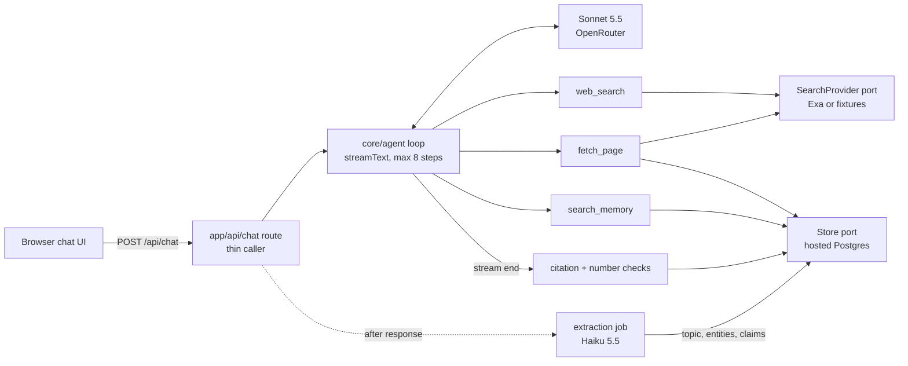
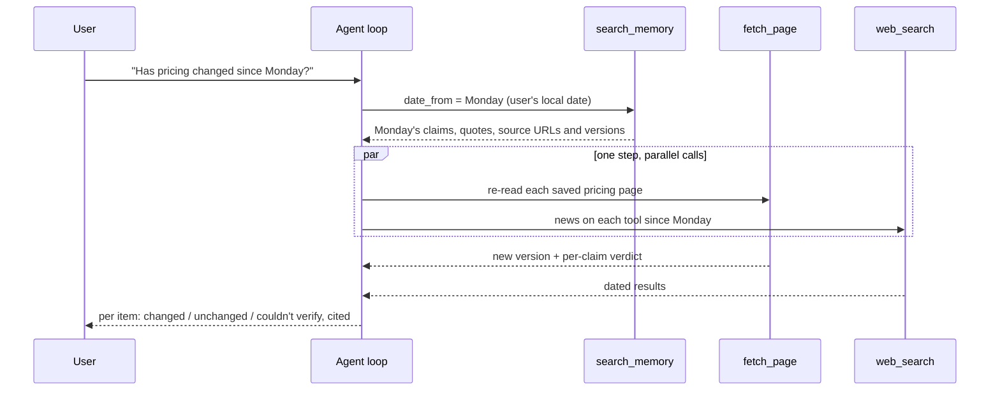
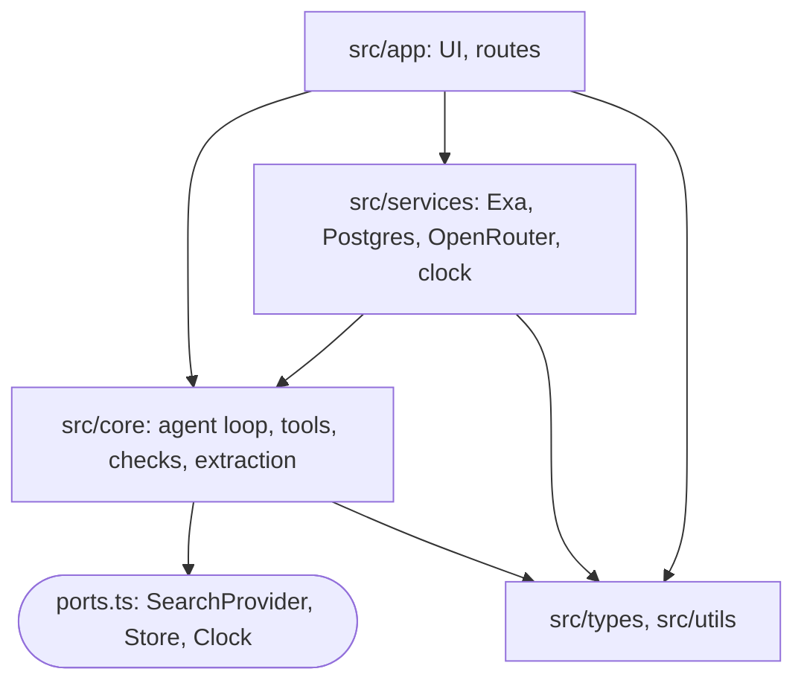

# Design

## How it works

The sample queries all point at a past conversation by date and ask what has changed since. So this is a memory-and-re-verification agent as much as a search agent.

One Next.js process runs the UI and the agent. A single model loop (Claude Sonnet 5.5 through OpenRouter, at most 8 steps) has three tools:

- **`web_search`**: Exa search, returning page text with each result.
- **`fetch_page`**: a fresh read of one page. It only accepts URLs that came from a search result or from the user's saved sources.
- **`search_memory`**: a database read over past exchanges, by local date, by topic, or both. The Minimi team confirmed a memory tool is allowed.



Every exchange is saved with its timestamp, the user's timezone, and the text of each page the agent read. Each full-page read gets a version number from a hash of its text, so two reads of the same URL can be compared. After the response is sent, a small model extracts the topic, the entities and the checkable claims (entity, attribute, value, supporting quote, source page).

For "has pricing changed since Monday?", one memory call returns Monday's claims and source URLs. The agent then re-reads those exact pages and searches for news on each tool, all in parallel:



Each request also carries the current date and a short index of recent topics. That lets a simple question use known context, and lets the agent say plainly when it has no record of a conversation (it then offers the nearest dates it does have).

## Why I built it this way

- **Evidence is stored and versioned, not just answers.** "Is it still correct?" is decided in code where it can be; only a missing quote goes to the model's judgement:

  ```mermaid
  flowchart LR
    R["fresh read of a saved page"] --> V{"same version<br/>as the claim's read?"}
    V -->|yes| U1["unchanged"]
    V -->|no| Q{"saved quote still<br/>in today's text?"}
    Q -->|yes| U2["unchanged<br/>page changed, fact did not"]
    Q -->|no| C["check: model compares<br/>claim with today's text"]
    R -.->|"fetch failed"| X["couldn't verify"]
  ```

- **Speed comes from fewer model calls.** There is no planning step, tool calls run in parallel, extraction happens after the response, and the stable prompt is cached. A simple question takes two model calls; a "what changed" question takes three.
- **Accuracy comes from checks in code.** Every citation must point to a page read in that exchange, and every cited number must appear in that page's text. Figures that fail are marked unverified. A failed search yields "couldn't verify", never an answer from the model's training data.
- **Injection is limited by what the tools can do.** The agent has no write tools, cannot fetch arbitrary URLs, and never takes a user id from the model. Per-answer budgets cap each tool. Web and memory content are both treated as untrusted data.
- **It is testable without the web.** The core imports only the AI SDK and zod, and depends on three small ports: search, store and clock. Tests and the eval swap in fixture pages with known content and a settable clock, so verdicts can be scored. The same clock lets a seed script recreate "last Tuesday" on a fresh clone. `npm run eval` scores 15 cases (the sample queries, empty history, a failed search, injection, timezones) with code checks on the tool trace and a small judge model for the answer text.



## Considered and rejected

| Rejected | Reason |
|---|---|
| A planner agent or model router | An extra model call on every query; the model's first step already is the plan |
| A second memory tool to open full exchanges | An extra round trip; claims already are the compact form of an answer |
| Embedding search from the start | The sample queries are date-anchored; full-text search and extracted topics cover them. The eval has paraphrased, dateless queries to test this |
| OpenRouter's built-in web search | It runs outside the loop, so fan-out and citations could not be controlled |
| Searching "changes since Monday" | Search engines filter by date poorly; re-reading the saved page is the direct check |
| A separate page-versions table | A version column on saved sources does the same job with one table fewer |
| Scoring the eval on the live web | Nobody knows whether a live price really changed; live runs measure latency only |
| A second model pass to verify numbers | Slower and less strict than a text match against the source |
| Postgres in Docker, or in-process PGlite | It has to run on `npm install` and `npm run dev`; a hosted Postgres (Neon or Supabase) needs only a connection string and is the real database |

## With another week

- Embedding search, if the eval shows topic misses.
- Auth, row-level security and rate limits.
- A parallel input classifier that can cancel a response without delaying the first token.
- Sub-agents with separate contexts for research across dozens of entities.
- A larger eval set with latency and accuracy tracked per change.
